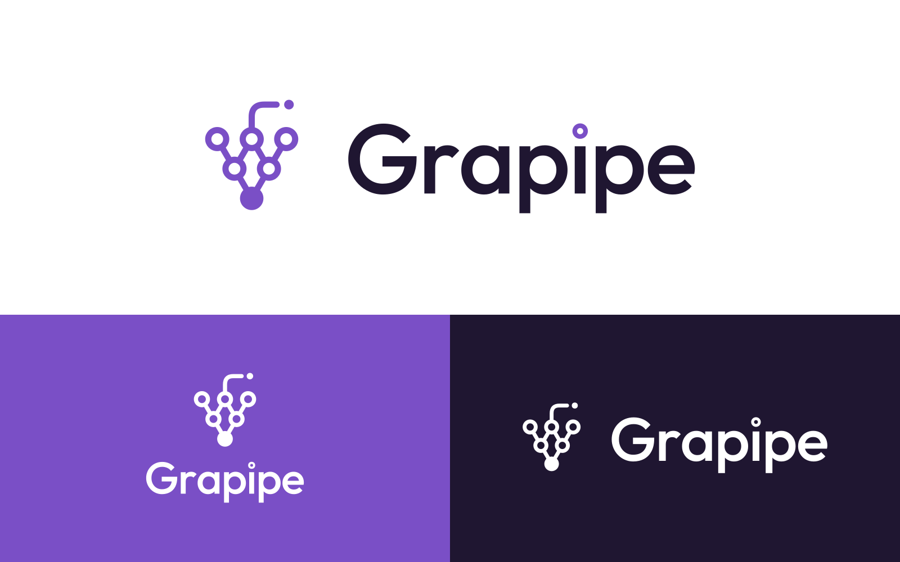

# Grapipe 브랜드 에셋

포도송이 노드가 파이프로 이어져 하나의 출력으로 모이는 심볼과, Outfit Medium을 아웃라인한 워드마크로 구성됩니다. 워드마크의 `i` 점은 심볼의 링 노드와 같은 요소입니다.

## 폴더 구성

| 폴더 | 내용 |
|---|---|
| `logo/svg/` | 원본 벡터. 인쇄·디자인 작업과 웹 모두 이 파일을 우선 사용 |
| `logo/png/` | 투명 배경 PNG. SVG를 못 쓰는 곳(문서, 메신저 등)용 |
| `favicon/` | 웹사이트 파비콘, iOS/안드로이드 홈 화면 아이콘, `site.webmanifest`, `<head>` 붙여넣기용 코드 |
| `social/` | SNS 프로필(1080×1080), 링크 미리보기 OG 이미지(1200×630) |
| `fonts/Outfit/` | 워드마크·브랜드 서체 (Regular / Medium / SemiBold, 라틴 서브셋) + 라이선스 |
| `preview/` | 전체 구성을 한 장에서 확인하는 시트 |

파일 이름 규칙: `grapipe-{구성}-{색상}.svg`

- 구성: `horizontal`(가로형, 기본) · `stacked`(세로형) · `icon`(심볼만) · `wordmark`(글자만)
- 색상: `color`(밝은 배경용) · `white`(보라·어두운 배경용) · `black`(흑백 인쇄용)

## 어떤 파일을 쓸까

- **웹사이트 헤더, 문서, 제안서 표지:** `horizontal-color` (어두운 배경이면 `horizontal-white`)
- **정사각형 공간(명함 뒷면, 포스터 중앙, 스플래시 화면):** `stacked`
- **SNS 프로필, 앱 아이콘:** `social/profile-1080.png`, `favicon/` 폴더의 아이콘
- **공간이 좁은 곳(내비게이션 바 축소 상태, 워터마크):** `icon`
- **팩스·도장·흑백 인쇄:** `black`

## 색상

| 이름 | HEX | RGB | 용도 |
|---|---|---|---|
| Grape Purple | `#7A4FC6` | 122, 79, 198 | 심볼, 강조, 브랜드 배경 |
| Deep Grape | `#1F1631` | 31, 22, 49 | 워드마크, 본문 텍스트, 어두운 배경 |
| Lavender Mist | `#F4F0FA` | 244, 240, 250 | 연한 배경, 카드 |
| White | `#FFFFFF` | 255, 255, 255 | 기본 배경, 반전 로고 |

명도 대비 (WCAG 기준):

- 흰 배경 위 Grape Purple **5.58:1** → 본문 크기 텍스트도 통과 (AA 4.5:1)
- Grape Purple 배경 위 흰 글자 **5.58:1** → 통과
- Lavender Mist 배경 위 Grape Purple **4.97:1** → 통과
- 흰 배경 위 Deep Grape **17.25:1**
- Deep Grape 배경 위 Grape Purple **3.09:1** → 로고·큰 제목만 가능, 본문 텍스트에는 쓰지 말 것. 어두운 배경에서는 `white` 버전 로고를 권장

## 서체

- **Outfit** (SIL Open Font License 1.1, 상업적 사용 무료)
- 워드마크: Outfit Medium(500)을 아웃라인으로 변환 후 자간 −2%, `i` 점을 링으로 교체. 워드마크는 글자를 다시 타이핑하지 말고 항상 로고 파일을 사용
- 브랜드 문서 제목: Outfit SemiBold(600) / 본문 영문: Outfit Regular(400)
- 동봉된 TTF는 영문·숫자만 들어 있는 라틴 서브셋입니다. 전체 문자셋(확장 라틴 포함)이 필요하면 Google Fonts에서 Outfit을 받으세요. 웹에서는 Google Fonts `family=Outfit:wght@400;500;600`로 불러오면 됩니다
- 한글은 Outfit에 없으므로 별도 서체가 필요합니다 (예: Pretendard, 둘 다 기하학적 산세리프라 잘 어울림)

## 여백과 최소 크기

- **보호 여백:** 로고 사방에 심볼 맨 아래 꽉 찬 노드의 지름(X)만큼 비워 두세요. 가로형 로고 높이 기준 약 21%입니다. SVG 파일에는 여백이 최소한만 들어 있으니, 배치할 때 여백을 따로 확보해야 합니다
- **최소 크기 (화면 기준):**
  - 가로형: 폭 140px 이상
  - 세로형: 폭 80px 이상
  - 심볼(선 버전): 48px 이상
  - 그보다 작을 때(32px 이하): `favicon/` 폴더의 채움 버전 사용. 링이 뭉개지지 않도록 노드를 채운 별도 도형입니다
- **인쇄:** 가로형 폭 30mm 이상 권장

## 하지 말 것

- 로고 비율을 늘리거나 줄이기, 기울이기, 회전
- 심볼과 워드마크의 간격·크기 비율 바꾸기 (가로형·세로형 파일을 그대로 사용)
- 워드마크를 다른 서체로 다시 쓰기, `i` 점을 일반 점으로 되돌리기
- 위 표에 없는 색 쓰기, 그라데이션·그림자·외곽선 효과 넣기
- 사진이나 복잡한 배경 위에 `color` 버전 올리기 (가독성이 떨어지면 단색 배경 박스 위에 올리거나 `white` 버전 사용)

## SNS 프로필 이미지

`social/profile-{배경}-bg-{로고}-logo-1080.png` (1080×1080). 모두 원형으로 잘려도 로고가 잘리지 않게 배치했습니다. 원형 미리보기는 `preview/profile-circle-preview.png`.

| 파일 | 배경 | 로고 | 추천 용도 |
|---|---|---|---|
| `purple-bg-white-logo` | Grape Purple | 흰색 | 기본 프로필 (가장 눈에 띔) |
| `white-bg-purple-logo` | 흰색 | Grape Purple | 밝은 톤 플랫폼, 문서 내 아바타 |
| `lavender-bg-purple-logo` | Lavender Mist | Grape Purple | 부드러운 인상, 흰 배경 UI에서 경계가 보이게 할 때 |
| `ink-bg-white-logo` | Deep Grape | 흰색 | 다크 모드 플랫폼 (GitHub, Discord 등) |
| `ink-bg-purple-logo` | Deep Grape | Grape Purple | 다크 톤 강조 (대비 3.09:1, 작은 크기에서는 흰 로고 권장) |
| `purple-bg-ink-logo` | Grape Purple | Deep Grape | 보조용 |
| `ink-bg-white-purple-logo` | Deep Grape | 흰색 + 보라 포인트 | 투톤. 출력 노드와 꼭지 점만 보라색 |
| `white-bg-ink-purple-logo` | 흰색 | Deep Grape + 보라 포인트 | 투톤. 격식 있는 자리(채용, 비즈니스 프로필) |

투톤 버전은 프로필 이미지 전용입니다. 로고 파일 자체는 한 가지 색으로만 씁니다.

## 웹사이트에 파비콘 넣기

`favicon/` 폴더의 파일을 웹 루트(`/`)에 복사하고, `favicon/head-snippet.html` 내용을 `<head>` 안에 붙여 넣으세요.
