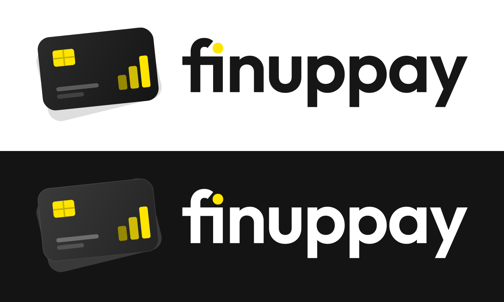

# finuppay 로고

카드 심볼 + `finuppay` 워드마크 가로형. 배경은 모두 투명입니다.

| 파일 | 용도 |
|---|---|
| `svg/finuppay-horizontal-for-light-bg.svg` | 흰색·밝은 배경 (워드마크 `#161616`) |
| `svg/finuppay-horizontal-for-dark-bg.svg` | 검정·어두운 배경 (워드마크 흰색, 카드를 한 톤 밝게 + 얇은 테두리) |
| `png/*@1200w.png`, `png/*@2400w.png` | SVG를 못 쓰는 곳용 투명 PNG |

- 워드마크: Outfit SemiBold(600) 아웃라인, 자간 −2%, 서체 기본 `fi` 합자 사용 (f와 i 점이 겹치지 않음)
- `i`의 점은 칩·막대와 같은 노란색 `#FFE500` (밝은·어두운 배경 버전 모두)
- 심볼 색: 칩·막대 `#FFE500`, 칩 선 `#C9B200`, 막대 `#968900` → `#D0BC05` → `#FFE500`
